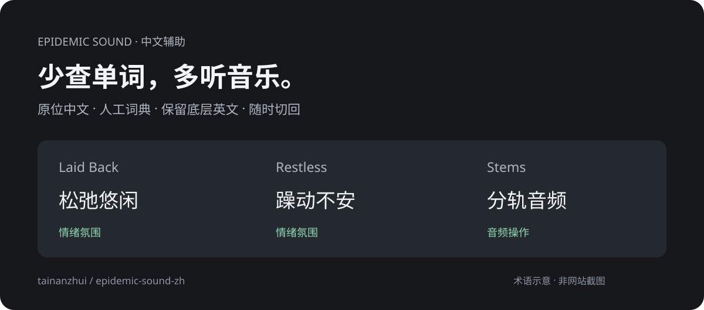

# Epidemic Sound 原生中文

**选音乐时，把注意力留给声音。**

[](https://github.com/tainanzhui/epidemic-sound-zh/actions/workflows/ci.yml)
[](https://github.com/tainanzhui/epidemic-sound-zh/releases)
[](LICENSE)

一个为中文创作者做的 Epidemic Sound 汉化小工具。菜单、情绪、曲风和常用操作在原位置显示中文，保留网站原来的排版和点击逻辑。

[安装油猴脚本](https://github.com/tainanzhui/epidemic-sound-zh/releases/latest/download/epidemic-zh.user.js) · [下载 Chrome 扩展](https://github.com/tainanzhui/epidemic-sound-zh/releases/latest/download/epidemic-zh-extension.zip) · [反馈漏译](https://github.com/tainanzhui/epidemic-sound-zh/issues/new/choose) · [English](README.en.md)



## 为什么做这个

剪视频时，我经常在 Epidemic Sound 里找配乐。音乐很好，但那些英文情绪和曲风标签，让“找感觉”变成了“查单词”。

直接翻译整页又让我担心误改网页参与交互的文字。所以做了这个工具：用人工整理的词典，在原位置显示中文，底层英文文本、链接和表单值仍然保留。

它从一个自己的小需求开始，也欢迎其他创作者一起把译法补得更准确。

## 现在能做什么

- **原位中文**：沿用网站字体、颜色、按钮和卡片布局。
- **311 条人工整理译文**：常用导航、情绪、曲风、部分主题与操作；曲目数量自动转换。
- **音乐语境译法**：`Laid Back → 松弛悠闲`、`Restless → 躁动不安`、`Stems → 分轨音频`。
- **保留原始数据**：不替换原英文文本节点，不改输入值、链接目标或网络请求。
- **动态页面适配**：翻页、筛选、加载新内容后，自动处理已收录词条。
- **一键切回英文**：右下角开关，或 `Alt + Shift + C`（Mac 为 `Option + Shift + C`）。

脚本本身不调用翻译 API，不发送页面文本，也不读取 Cookie。油猴管理器会按自身设置从 GitHub 检查更新；网站自己的请求照常运行。

## 安装

### 推荐：油猴脚本

1. 浏览器安装 [Tampermonkey](https://www.tampermonkey.net/)。
2. 点击 **[安装 Epidemic Sound 原生中文](https://github.com/tainanzhui/epidemic-sound-zh/releases/latest/download/epidemic-zh.user.js)**，在油猴页面确认安装。
3. 打开或刷新 [Epidemic Sound](https://www.epidemicsound.com/music/featured/)。

如果链接只下载了文件：打开油猴管理面板 → 实用工具 → 从文件导入，选择 `.user.js`。若脚本没有运行，请按油猴提示启用浏览器的用户脚本支持。

### Chrome / Edge 扩展版

1. [下载扩展 ZIP](https://github.com/tainanzhui/epidemic-sound-zh/releases/latest/download/epidemic-zh-extension.zip)，解压到固定文件夹。
2. 打开 `chrome://extensions`（Edge：`edge://extensions`），启用开发者模式。
3. 点击「加载已解压的扩展程序」，选择含 `manifest.json` 的文件夹。
4. 刷新 Epidemic Sound。

两个版本二选一。扩展版尚未上架商店，更新时下载新版、替换文件，再在扩展管理页重新加载。停用或卸载后刷新网页即可恢复。

## 覆盖范围与已知限制

这是**持续补词的早期版本**，还不是全站完整翻译。

- 歌名、艺人名保留原文；未收录长文和部分复杂组件仍会显示英文。
- 搜索框输入不会自动中英转换；你的输入仍按原样交给网站。
- CSS 生成的中文可能与英文一起进入无障碍名称，读屏软件可能重复朗读。
- 目前每次打开页面默认开启中文；开关状态不跨刷新保存。
- 网站结构变化可能造成漏译或排版问题。可先切回英文，再[提交问题](https://github.com/tainanzhui/epidemic-sound-zh/issues/new/choose)。

实站已观察到中文导航、筛选栏及下载窗口正常显示，英文筛选参数保持原样。测试覆盖原文、链接、表单值、动态节点复用和开关恢复。**完整下载文件落盘、全部筛选组合及扩展版独立加载尚未完成验收。** 详见 [验证说明](docs/verification.md)。

## 一起补全它

遇到漏译或译法不自然，欢迎提交 Issue：**页面位置 + 英文原词 + 建议中文**。可以附局部截图，请遮掉账号和个人信息。

会写代码的话，也欢迎直接修改 [`dictionary.json`](dictionary.json) 后提 PR。词典是唯一的翻译来源，油猴和扩展由同一份代码生成。参见 [贡献指南](CONTRIBUTING.md)。

## 本地开发

需要 Node.js 24 和 Python 3。

```sh
npm ci
npm run build
npm test
```

- `dictionary.json`：人工词典。
- `runtime.js`：原位显示、动态观察与关闭恢复逻辑。
- `build.py`：生成油猴脚本、扩展和发布 ZIP。
- `test.cjs`：DOM 兼容性回归测试。

通过 CSS 生成内容显示译文，原节点保持原英文；翻译只处理可适配的元素，并跳过输入区、编辑区和曲目/艺人链接。这个方法降低改动业务文本的风险，但不等于对网站全部内部逻辑和遥测的保证。

## 关于

由 [tainanzhui](https://github.com/tainanzhui) 维护。从日常创作遇到的问题出发，做一些能直接用的小工具。

本项目与 Epidemic Sound 无隶属关系；不提供音乐资源，不改变订阅或授权要求。代码采用 [MIT License](LICENSE)。
